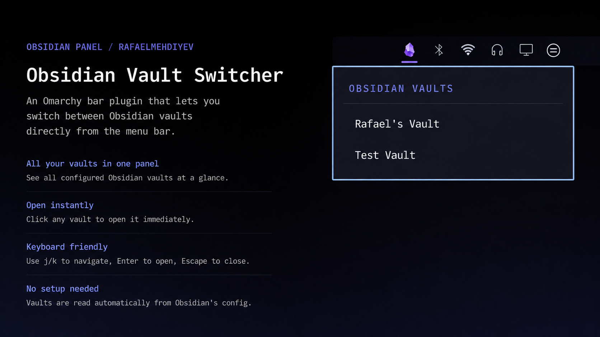

# Obsidian Panel

An Omarchy bar plugin that lets you switch between Obsidian vaults and search notes across vaults from the menu bar.


## Features

- Shows all your Obsidian vaults in a panel
- Click any vault to open it instantly
- Search your notes across every vault from one search bar
- Create a new empty vault directly from the panel
- Keyboard navigation (Up/Down to move, Enter to open, Escape to close)
- Automatically reads vaults from Obsidian's config - NO MANUAL SETUP

## Requirements

- [Obsidian](https://obsidian.md)

## Install

```bash
omarchy plugin add https://github.com/rafaelmehdiyev/omarchy-obsidian-panel --enable
```

## Preview


